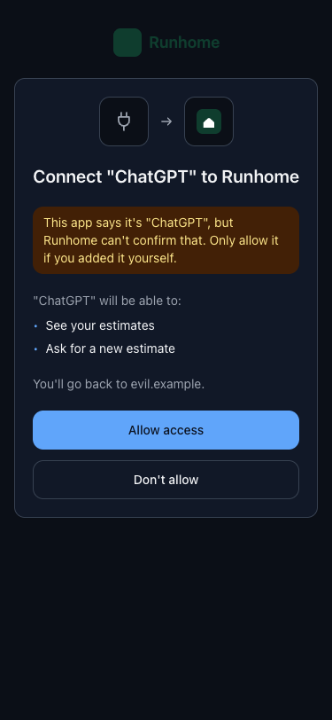

# mcp-connect-kit

Sign-in and consent screens for MCP servers that use OAuth, so people can see which app is asking for access before they allow it.

- **Know which app is connecting.** The kit checks facts an app can't fake, like where its sign-in returns to. It never trusts the name the app sends.
- **Ready-made screens.** Sign-in and consent screens for React that name the app, list what it can do, and warn when something looks wrong.
- **Your look.** Colours, fonts, logo and every line of text can be changed. Works with Tailwind 4 or plain CSS, in light and dark.
- **Safe by default.** App logos and details are fetched over HTTPS from public addresses only, and logos are served from your own domain.
- **Fits your OAuth server.** Built for Better Auth, and runs on Node and Cloudflare Workers.

<p>
  
  
  
</p>

## Install

```sh
npm install mcp-connect-kit
```

You also need React for the screens.

## Show a consent screen

```tsx
import { identifyClient } from 'mcp-connect-kit';
import { ConnectFrame, ConsentView } from 'mcp-connect-kit/react';

const client = identifyClient({ clientId, redirectUri, metadata }); // from your OAuth server

<ConnectFrame theme={{ app: { name: 'Runhome', logo: '/logo.svg' } }}>
  <ConsentView
    client={client}
    scopes={[{ id: 'estimates:read', label: 'See your estimates' }]}
    onAllow={allow}
    onDeny={deny}
  />
</ConnectFrame>;
```

When ChatGPT connects, the screen says "Connect ChatGPT to Runhome" and "You'll go back to chatgpt.com." When an app only says it's ChatGPT, the screen puts its name in quotes, shows a plug icon instead of a logo, and warns the person.

## Supported clients

The kit knows these apps:

| App         | Recognised by                                                                                          | Logo                                          | Status              |
| ----------- | ------------------------------------------------------------------------------------------------------ | --------------------------------------------- | ------------------- |
| ChatGPT     | Its client metadata document, `https://chatgpt.com/oauth/client.json`, or its connector return address | The logo in its document, or the included one | Checked             |
| Codex       | Its client metadata document, `https://chatgpt.com/oauth/codex/client.json`                            | The logo in its document, or the included one | Checked             |
| Claude      | Its return address, `https://claude.ai/api/mcp/auth_callback`                                          | Included                                      | Checked             |
| Claude Code | Its client metadata document, `https://claude.ai/oauth/claude-code-client-metadata`                    | Included                                      | Checked             |
| VS Code     | Its client metadata document, `https://vscode.dev/oauth/client-metadata.json`                          | The logo in its document                      | Checked             |
| Gemini app  | Its return address on `oauth-redirect.googleusercontent.com`                                           | Included                                      | Opt-in, unconfirmed |
| Cursor      | Its return address, `cursor://anysphere.cursor-mcp/oauth/callback`                                     | Included                                      | Opt-in, unconfirmed |
| Gemini CLI  | Can't be confirmed: it only sends its name                                                             | None. It gets a plug icon and a warning       | —                   |

- **Checked:** we tested the rule against the app itself on 10 Nov 2026. These are in `defaultClients`.
- **Opt-in, unconfirmed:** the rule comes from a walkthrough (Gemini app) or forum posts (Cursor), not a sign-in we've tried. Turn them on with `[...defaultClients, ...unverifiedClients]`.
- **Any other app** shows the name it sent, in quotes, with a plug icon and a warning.

To add your own app, use `defineClient`:

```ts
import { defaultClients, defineClient, identifyClient } from 'mcp-connect-kit';

const acme = defineClient({
  id: 'acme',
  name: 'Acme Agent',
  metadataUrls: ['https://acme.dev/oauth/client.json'],
  logoHosts: ['cdn.acme.dev'],
});

identifyClient({ clientId, redirectUri, metadata, clients: [...defaultClients, acme] });
```

`defineClient` refuses rules that prove nothing, like a `localhost` return address.

## What's in the package

| Import                             | Use it for                                                                    |
| ---------------------------------- | ----------------------------------------------------------------------------- |
| `mcp-connect-kit`                  | Working out which app is connecting, and fetching its details and logo safely |
| `mcp-connect-kit/react`            | The sign-in and consent screens                                               |
| `mcp-connect-kit/tailwind.css`     | Styling the screens in a Tailwind 4 app                                       |
| `mcp-connect-kit/react/styles.css` | Styling the screens in an app without Tailwind                                |
| `mcp-connect-kit/node`             | Fetching on Node, connected only to addresses the kit checked                 |
| `mcp-connect-kit/better-auth`      | Connecting the kit to Better Auth                                             |

## How the kit knows which app is connecting

```ts
const client = identifyClient({ clientId, redirectUri, metadata });
// { id: 'chatgpt', name: 'ChatGPT', via: 'metadata-url', returnHost: 'chatgpt.com',
//   returnsTo: 'website', logo: 'metadata', logoUri: 'https://…', warnings: [] }
```

It checks three things, strongest first:

1. **The client metadata document URL.** With a client ID metadata document (CIMD), the client ID is an HTTPS address only that app can publish at. Pass it in only after your server has fetched the document and checked that its `client_id` matches.
2. **The return address.** An HTTPS address the app controls, like `https://claude.ai/api/mcp/auth_callback`, proves the app gets the sign-in. A `localhost` address proves nothing, because any program on the computer can use it.
3. **The name.** Shown in quotes. A name alone never gets an app's logo.

`warnings` tells the screen what to point out:

| Warning                   | When                                                                                              |
| ------------------------- | ------------------------------------------------------------------------------------------------- |
| `unknown-client`          | Nothing matched a supported app.                                                                  |
| `name-claims-known-brand` | An unknown app's name includes a supported app's name, like "ChatGPT Helper".                     |
| `localhost-only`          | The person goes back to an app on their own computer. Any program could be that app.              |
| `logo-host-differs`       | A supported app's document points to a logo somewhere unexpected. The kit shows the included one. |

The screen shows one warning at most: the computer warning first, then the name warning, then the unknown-app warning.

## Read a client metadata document

`readClientMetadata` checks a fetched document against what your server offers:

- `client_id` must match the address the document came from.
- Only the grant and response types you offer are kept. When an app adds a grant type you don't offer, as ChatGPT did with `jwt-bearer`, its document still works.
- Shared secrets, hidden characters in the name, and return addresses with a `#` are refused.
- `logo_uri`, `client_uri` and `jwks_uri` are kept only if they use HTTPS.

```ts
const document = readClientMetadata(json, {
  url,
  grants: ['authorization_code', 'refresh_token'],
  authMethods: ['none', 'private_key_jwt'],
});
```

It throws a `ClientMetadataError` with the code `invalid_client_metadata`.

## Fetch documents and logos safely

An app chooses its own client ID address, and your server fetches it. So every fetch:

- uses HTTPS, sends no cookies, and doesn't follow redirects;
- refuses private and local addresses before connecting;
- accepts only a `200` answer within 3 seconds;
- reads at most 5 KB for a document and 256 KB for a logo.

```ts
import { createMetadataFetcher } from 'mcp-connect-kit';
import { nodeTransport } from 'mcp-connect-kit/node';

const fetchMetadata = createMetadataFetcher(nodeTransport);
const json = await fetchMetadata('https://chatgpt.com/oauth/client.json');
```

On Node, `nodeTransport` connects only to addresses the kit checked. On Cloudflare Workers, leave it out.

### Logos

The screens load an app's logo from your own domain, so the person's browser never contacts the app's servers.

```ts
import { createLogoProxy, logoPath } from 'mcp-connect-kit';

// app/oauth/client-logo/[hash]/route.ts
export const GET = createLogoProxy(nodeTransport);

// On the consent page, when client.logo is 'metadata'
const logoSrc = await logoPath(client.logoUri);
```

The route only fetches from hosts a supported app lists in `logoHosts`. It accepts PNG, JPEG and WebP up to 1024 × 1024 pixels, checked by the file's contents. It refuses SVG, which can contain scripts. If a logo can't be fetched, it serves a plug icon.

It needs no storage. Logos are cached by your CDN for a day, and failures for 10 minutes. On Cloudflare Workers it also uses `caches.default`.

## Screens

```tsx
<ConnectFrame
  theme={{
    app: { name: 'Runhome', logo: '/logo.svg', icon: '/icon.svg' },
    color: { accent: '#0b6' },
    font: 'Inter, system-ui',
    radius: 12,
  }}
>
  <ConsentView client={client} logoSrc={logoSrc} scopes={scopes} onAllow={allow} onDeny={deny} />
</ConnectFrame>
```

- `ConsentView` asks the person to allow access.
- `SignInHeader` goes above your own sign-in form.
- `DecisionView` says what happened after the person decides.
- `ReturnView` shows while the person goes back to the app, with a link in case the browser doesn't go back on its own.

Every line of text can be replaced through `copy`. Each part of the consent screen takes a class name through `classNames`. Set `colorScheme` to `auto`, `light` or `dark`.

### Styling

**With Tailwind 4,** import the kit after Tailwind and set its colours from your own theme:

```css
@import 'tailwindcss';
@import 'mcp-connect-kit/tailwind.css';

@theme {
  --color-mcpc-accent: var(--color-brand);
}
```

**Without Tailwind,** import `mcp-connect-kit/react/styles.css`. It styles only the screens.

### Logos on the screens

For an app the kit recognised, the screen shows the first of these it has: the logo from the app's own document, your logo for that app, the logo included in the kit, or a plug icon. An app known only by its name always gets the plug icon.

```tsx
<ConnectFrame theme={theme} marks={{ chatgpt: MyOpenAiLogo }}>…</ConnectFrame>
<ConnectFrame theme={theme} marks={false}>…</ConnectFrame> {/* no included logos */}
```

Apps in one family share a logo: the Gemini app and Gemini CLI both use Gemini's. The included logos come from [lobe-icons](https://github.com/lobehub/lobe-icons) (MIT). They're shown only to name the app that's really connecting.

## Use with Better Auth

```ts
import { cimd } from '@better-auth/cimd';
import { cimdOptions, consentContext } from 'mcp-connect-kit/better-auth';
import { nodeTransport } from 'mcp-connect-kit/node';

cimd({ ...cimdOptions({ ...nodeTransport, grants: ['authorization_code', 'refresh_token'] }) });

// On the consent page, with Better Auth's stored client and this request's return address
const { client, logoSrc } = await consentContext({ client: oauthClient, redirectUri });
```

`cimdOptions` fetches client metadata documents the safe way, and drops grant types you don't offer. `consentContext` gives the consent screen what it needs. The kit doesn't issue or check tokens: `@better-auth/mcp` does that.

## Licence

MIT. App names and logos belong to their owners. This project isn't affiliated with or endorsed by any of them. Visual Studio Code is a trademark of Microsoft Corporation.
