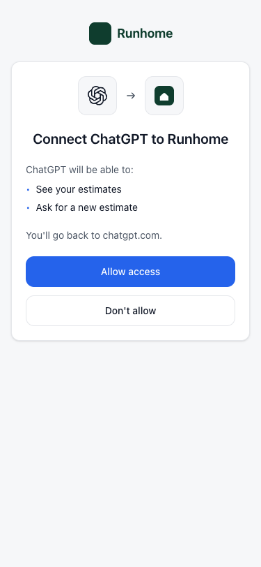
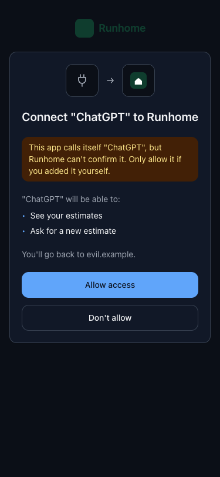
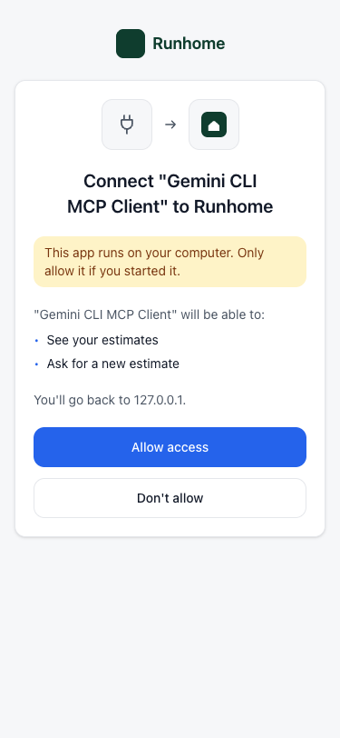

# mcp-connect-kit

Shared pieces for MCP servers that people connect to from ChatGPT, Claude, VS Code and other clients:

- **Recognise the client** from facts the server can check (its metadata document URL or its redirect URI), never from the name it sends.
- **Fetch client metadata documents and logos safely**, without reaching private addresses.
- **Sign-in and consent screens** in React and Tailwind, which name the client, say where the person goes back to, and warn about apps the server can't confirm.
- **Widget helpers** for MCP Apps and ChatGPT, where older template URIs keep working after a deploy.

The package is being built in small steps. It isn't on npm yet.

## Recognise the client

```ts
import { identifyClient, readClientMetadata } from 'mcp-connect-kit';

const client = identifyClient({
  clientId, // a metadata document URL (CIMD) or an opaque id (DCR)
  redirectUri, // the redirect of this authorization request
  metadata, // the stored metadata document or registration
});
// { id: 'chatgpt', name: 'ChatGPT', via: 'metadata-url', returnHost: 'chatgpt.com',
//   logo: 'metadata', logoUri: 'https://persistent.oaistatic.com/…', warnings: [] }
```

The kit decides who a client is from facts the server can check, strongest first:

1. **The metadata document URL.** For a client ID metadata document, the client ID is an HTTPS URL that only the product can publish at. Pass a client ID only after the server has fetched that URL and checked that the document's `client_id` equals it.
2. **The redirect URI.** An HTTPS callback the product controls, such as `https://claude.ai/api/mcp/auth_callback`, proves the authorization code reaches that product. Loopback redirects (`127.0.0.1`, `localhost`) prove nothing, because any program on the computer can listen there.
3. **The name.** Whatever the client sent. It is shown in quotes and never earns a product's name or logo.

`warnings` lists what the person should know before allowing the client:

| Warning                   | When                                                                                                                                 |
| ------------------------- | ------------------------------------------------------------------------------------------------------------------------------------ |
| `unknown-client`          | No metadata URL or redirect matched a known client.                                                                                  |
| `name-claims-known-brand` | An unknown client's name contains a known product's name, such as "ChatGPT Helper".                                                  |
| `localhost-only`          | The person goes back to an address on their own computer. Known native apps get it too, since any program can reuse their client ID. |
| `logo-host-differs`       | A known client's document points its logo at a host its entry doesn't list. The kit shows its mark instead.                          |

### The clients it knows

| Client      | Known by                                                                                            | Logo in its document          |
| ----------- | --------------------------------------------------------------------------------------------------- | ----------------------------- |
| ChatGPT     | `https://chatgpt.com/oauth/client.json` (and `/oauth/{id}/client.json`), or its connector callbacks | on `persistent.oaistatic.com` |
| Codex       | `https://chatgpt.com/oauth/codex/client.json`                                                       | on `persistent.oaistatic.com` |
| Claude      | the callback `https://claude.ai/api/mcp/auth_callback`                                              | none                          |
| Claude Code | `https://claude.ai/oauth/claude-code-client-metadata`                                               | none                          |
| VS Code     | `https://vscode.dev/oauth/client-metadata.json` (and Insiders)                                      | on `code.visualstudio.com`    |
| Gemini CLI  | its name only, so it stays unknown; its own name doesn't count as claiming Google's brand           | none                          |

Clients from one product share a `family`, which picks their mark: Gemini CLI and the Gemini app are both `gemini`. `identifyClient` returns the family only for a client it recognised, so a client known only by its name never gets a mark.

The Gemini app and Cursor are in `unverifiedClients`. Their rules come from one walkthrough and from forum reports, and haven't been checked in a real sign-in yet. Opt in with `[...defaultClients, ...unverifiedClients]`.

Add your own clients with `defineClient`. It refuses rules that would prove nothing, such as a loopback host or a plain HTTP redirect.

```ts
import { defaultClients, defineClient, identifyClient } from 'mcp-connect-kit';

const acme = defineClient({
  id: 'acme',
  name: 'Acme Agent',
  metadataUrls: ['https://acme.dev/oauth/client.json'],
  logoHosts: ['cdn.acme.dev'],
  brandNames: ['acme'],
});
identifyClient({ clientId, redirectUri, metadata, clients: [...defaultClients, acme] });
```

## Read a client metadata document

`readClientMetadata` checks a fetched document against what your server offers, and normalises it:

- `client_id` must equal the URL it came from.
- Only the grant and response types you offer are kept. So when a vendor adds a grant, as ChatGPT did with `jwt-bearer`, the document still works. It is refused only when nothing usable is left.
- Shared secrets, hidden characters in the name, and redirects with fragments are refused.
- `logo_uri`, `client_uri` and `jwks_uri` are kept only when they are HTTPS.

```ts
const document = readClientMetadata(json, {
  url,
  grants: ['authorization_code', 'refresh_token'],
  authMethods: ['none', 'private_key_jwt'],
});
```

It throws a `ClientMetadataError` whose `code` is `invalid_client_metadata`.

## Fetch documents and logos safely

A client ID is a URL a stranger chose, so the server fetches it the careful way.

```ts
import { createMetadataFetcher } from 'mcp-connect-kit';
import { nodeTransport } from 'mcp-connect-kit/node';

const fetchMetadata = createMetadataFetcher(nodeTransport);
const json = await fetchMetadata('https://chatgpt.com/oauth/client.json');
```

Every fetch:

- uses HTTPS only, sends no cookies, and follows no redirects;
- refuses private, loopback, link-local and other special-use addresses before connecting;
- accepts only a `200` answer, within 3 seconds;
- reads at most 5 KB for a document and 256 KB for a logo.

`mcp-connect-kit/node` resolves every address a host has and connects only to an address it checked, so DNS can't change between the check and the connection. On Cloudflare Workers, leave the transport out: Workers can't reach private addresses, and the kit still refuses private IP literals and `localhost`.

The fetcher keeps nothing. `@better-auth/cimd` already stores each document with its client.

### The logo route

The screens never load a vendor's logo directly. They load it from your own domain, through one route:

```ts
import { createLogoProxy, logoPath } from 'mcp-connect-kit';

// app/oauth/client-logo/[hash]/route.ts
export const GET = createLogoProxy(nodeTransport);

// On the consent screen, when identifyClient returned logo: 'metadata'
const src = await logoPath(client.logoUri); // /oauth/client-logo/<hash>?src=…
```

The route fetches a logo only from a host that an allowlisted client lists in `logoHosts`. It accepts PNG, JPEG or WebP, recognised by the file's first bytes rather than its declared type, so SVG, which can carry script, is refused. Images can be at most 1024 × 1024 pixels. The person's browser never contacts the vendor.

| Answer      | Headers                                                                                                                                                 |
| ----------- | ------------------------------------------------------------------------------------------------------------------------------------------------------- |
| The logo    | `Cache-Control: public, s-maxage=86400, stale-while-revalidate=86400`, `X-Content-Type-Options: nosniff`, `Content-Security-Policy: default-src 'none'` |
| A plug icon | The same, but `Cache-Control: public, s-maxage=600`, so a vendor's fix shows within 10 minutes                                                          |

There is no cache store to set up. Vercel and most CDNs keep the answer because of `Cache-Control`. On Cloudflare Workers the route also uses the built-in `caches.default`.

## Sign-in and consent screens

<p>
  
  
  
</p>

```tsx
import { ConnectFrame, ConsentView } from 'mcp-connect-kit/react';

<ConnectFrame
  theme={{
    app: { name: 'Runhome', logo: '/logo.svg', icon: '/icon.svg' },
    color: { accent: '#0b6' },
    font: 'Inter, system-ui',
    radius: 12,
  }}
>
  <ConsentView
    client={client} // from identifyClient
    logoSrc={client.logo === 'metadata' ? await logoPath(client.logoUri) : undefined}
    scopes={[{ id: 'estimates:read', label: 'See your estimates' }]}
    onAllow={allow}
    onDeny={deny}
  />
</ConnectFrame>;
```

The screens always name the client and say where the person goes back to. A client the kit couldn't confirm is shown in quotes, with a plug icon and one warning line above the permissions. `SignInHeader` tops your own sign-in form. `DecisionView` and `ReturnView` say what happened.

### Styling

The screens are written in Tailwind 4 classes on the kit's own tokens (`bg-mcpc-accent`, `text-mcpc-ink`, `rounded-mcpc`, …), with light and dark sets.

- **A Tailwind 4 app** imports the kit after Tailwind, then points the tokens at its own colours, or passes a `theme`:

  ```css
  @import 'tailwindcss';
  @import 'mcp-connect-kit/tailwind.css';

  @theme {
    --color-mcpc-accent: var(--color-brand);
  }
  ```

- **An app without Tailwind** imports the built stylesheet: `import 'mcp-connect-kit/react/styles.css'`. It has no global reset; it only styles the screens.

`colorScheme` is `auto` (follow the device), `light` or `dark`. Every string can be replaced through `copy`, and each part of the consent screen takes a class name through `classNames`.

### Client marks

A client recognised by its metadata URL or redirect shows, in order: the logo from its own metadata document (through your logo route), your mark for its id, the kit's bundled mark, or a plug icon. A client known only by its name always gets the plug.

```tsx
<ConnectFrame theme={theme} marks={{ chatgpt: MyOpenAiMark }}>…</ConnectFrame>
<ConnectFrame theme={theme} marks={false}>…</ConnectFrame> {/* no bundled marks */}
```

The bundled marks for ChatGPT, Codex, Claude, Claude Code, Gemini and Cursor come from [lobe-icons](https://github.com/lobehub/lobe-icons) (MIT). VS Code sends its own logo, so it has none. The marks stay their owners' trademarks. The kit shows one only to name the product that is really connecting.

## Licence

MIT. Client names and logos belong to their owners. This project isn't affiliated with or endorsed by any of them. Visual Studio Code is a trademark of Microsoft Corporation.
